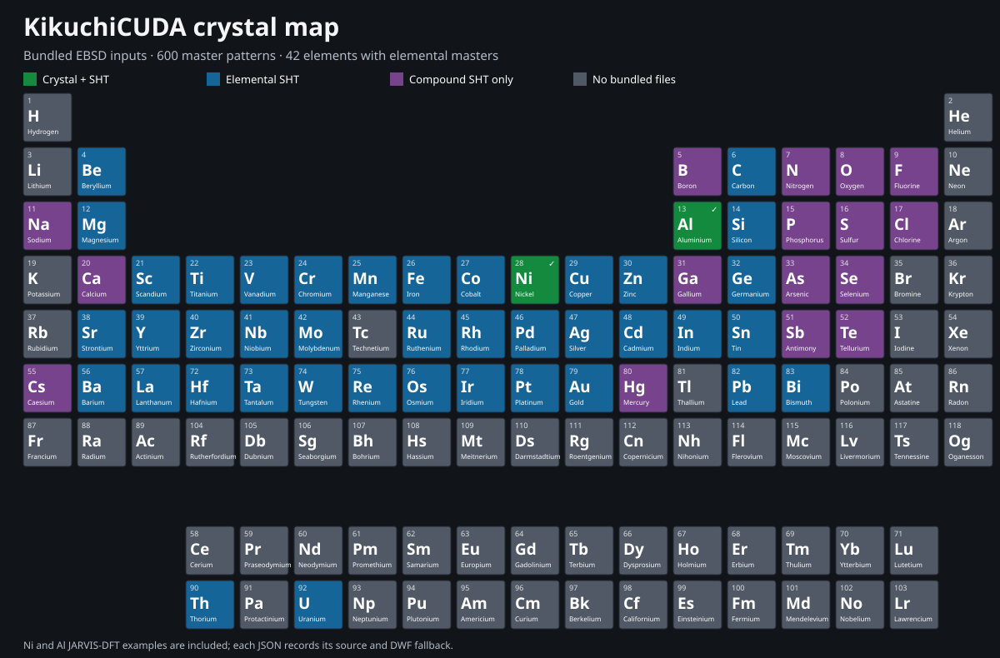

# GPU EBSD dictionary indexing on HPC

Load a bundled SHT master, use an existing HDF5 master, or generate a master from a crystal structure. Project a dictionary and match experimental
patterns on NVIDIA GPUs. The pipeline uses a Python dynamical master generator,
kikuchipy 0.13.1 detector geometry, a CuPy projector and a batched NCC matcher.
Two GPUs project the dictionary and dynamically claim experimental-pattern
chunks during matching, so a GPU that finishes one chunk can take the next.

The CuPy projector derives from the EMsoft port and uses kikuchipy detector geometry. The HPC matcher implements normalized cross-correlation in CuPy.

The Python import name remains `emsoft_di`. The repository folder can have any
name. Upstream EMsoft attribution and license are retained in `LICENSE`.

## 1. Prepare the files

The default layout is:

```text
~/kikuchipyCUDA/
  patterns.up1
  crystal.xtal                     # EMsoft crystal structure HDF5 (CrystalData)
  master-source.h5                 # optional existing EMsoft Monte Carlo HDF5
  scan.ang
  dictionary-indexing-cuda/       # clone this repository here
  KikuchiPyCUDA/                 # Conda environment, created below
```

Inputs are raw UP1 experimental patterns and ANG scan coordinates with detector
calibration in the header. You can either provide a crystal structure HDF5 and
generate Monte Carlo data in Python/CuPy, or provide an existing EMsoft
Monte Carlo HDF5. Python-generated Monte Carlo output also records scattering-
event positions for an x-z cross-section of the electron interaction volume.
Its interactive HTML map uses logarithmic color and shows event counts on hover.
Legacy EMsoft files without trajectory positions retain the depth-by-energy heat
map. Supply your own experimental UP1 and matching ANG scan. The repository includes example crystals and 600 EBSD masters in the [SHT database](SHTdatabase-master/EBSD). This workflow assumes alternating hex-row scan coordinates and a rectangular
UP1 raster. It is not a generic reader for every vendor scan layout; validate
the coordinate mapping for your acquisition.

Use `KIKUCHIPY_CUDA_ROOT` to change the data root. The Python command also accepts
explicit `--patterns`, `--master`, and `--ang` paths. See `--help` for all options.

## 2. Create the environment on HPC

On Kamiak, from your cloned repository:

```bash
module load miniconda3/26.5
source "$(conda info --base)/etc/profile.d/conda.sh"
conda env create --prefix "$HOME/kikuchipyCUDA/KikuchiPyCUDA" -f environment.yml
conda activate "$HOME/kikuchipyCUDA/KikuchiPyCUDA"
python -m pip install -e '.[hpc]'
```

If that environment already exists, activate it and install the editable package;
do not recreate it. The environment uses Python 3.11, kikuchipy 0.13.1,
diffpy.structure and CuPy 13.6.0 for CUDA 12.x. The system Python module is not
needed. On the tested compute node, its Python 3.11.4 installation could not
find `libffi.so.6`.

### Index with a bundled SHT master

From the repository root, with the HPC Conda environment active, compile the
decoder once. The [SHTfile header](tools/sht/sht_file.hpp) and its license are
included. The decoder verifies the checksum and unpacks the harmonic coefficients.

```bash
module load gcc
c++ -std=c++14 -O2 tools/sht/read_sht.cpp -o "$CONDA_PREFIX/bin/emsoft-di-read-sht"
```

Choose a [database file](SHTdatabase-master/EBSD) matching the phase and beam
voltage of your scan. For nickel at 20 kV, run these commands from the repository
root. Keep the absolute path quoted because the batch job changes directories.

```bash
sht_master="$PWD/SHTdatabase-master/EBSD/Cubic/Ni (nickel) [A1]/Ni (nickel) [A1] {20kV}.sht"
python -m emsoft_di.hpc --master "$sht_master" --dry-run --output "$HOME/kikuchipyCUDA/input-check"
sbatch hpc/submit_two_gpu.slurm --master "$sht_master"
```

The dry run reads the experimental inputs and reconstructs the master on CPU.
The batch command submits the 128-pattern pilot. After reviewing it, submit
the full scan with the same master:

```bash
sbatch hpc/submit_two_gpu.slurm --master "$sht_master" --limit 0 --resolution 1
```

Python synthesizes north and south square Lambert maps in memory. The SHT
retains the simulation beam voltage and contains one angular intensity pattern.
Separate electron energy bins cannot be recovered. The loader therefore skips
Monte Carlo weighting and uses the file’s effective space group for orientation
sampling. This indexing route starts directly from the SHT and requires no H5
conversion or master-generation job. See the [database attribution](SHTdatabase-master/README.md)
and [license](SHTdatabase-master/LICENSE).

## 3. Check inputs and run tests

Input inspection works on a login node and does not allocate a GPU:

```bash
python -m emsoft_di.hpc --dry-run --output "$HOME/kikuchipyCUDA/input-check"
```

For GPU validation, request a compute-node allocation:

```bash
srun --partition=camas --nodes=1 --ntasks=1 --gres=gpu:2 \
  --cpus-per-task=8 --mem=32G --time=00:15:00 --pty bash
module load miniconda3/26.5
module load gcc
module load cuda/12.2.0
source "$(conda info --base)/etc/profile.d/conda.sh"
conda activate "$HOME/kikuchipyCUDA/KikuchiPyCUDA"
cd "$HOME/kikuchipyCUDA/dictionary-indexing-cuda"
python -m unittest discover -s tests -v
```

CPU tests can run without GPUs. A skipped CUDA test means GPU execution was not
validated in that session. The projection test compares against kikuchipy;
when GPUs are visible it checks them as well. Tests use synthetic data.

## 4. Generate a master in Python, then index

The full pipeline can create its Monte Carlo input from a crystal HDF5, then
generate a master, project the dictionary, and index the experimental scan. The
new Monte Carlo stage runs in Python/CuPy and does not launch EMsoft or require a
Fortran runtime. It reads the crystal structure (`CrystalData`) from an EMsoft
`.xtal` file or another HDF5 containing that group, simulates the selected
number of incident electrons, and writes energy, exit-depth, and trajectory
histograms to a new HDF5. The output includes `accum_e`, `accum_z`, and the
KikuchiCUDA extension `accum_path`, which stores scatter-event counts in the
beam-tilt-plane lateral-position/depth cross-section. It does not write EMsoft's
optional `accumSP` visualization dataset.

Depth and lateral histogram limits are independent. For a 10 µm depth range,
±2 µm lateral range, and 0.5 nm bins, set
`KIKUCHIPY_CUDA_MC_DEPTH_MAX_NM=10000`,
`KIKUCHIPY_CUDA_MC_LATERAL_MAX_NM=2000`, and
`KIKUCHIPY_CUDA_MC_DEPTH_STEP_NM=0.5` before submitting the interaction-volume
job. This produces 20,001 depth bins by 8,001 lateral bins in `accum_path`.

Crystal files can also be created entirely in Python, without running
`EMmkxtal` or Fortran. To reuse the crystal already stored in an EMsoft result:

```bash
python -m emsoft_di.crystal_file extract \
  --input "$HOME/emsoft-port/data/EMMCopenCL_MCMP.h5" \
  --output "$HOME/kikuchipyCUDA/crystal.xtal"
```

To enter a different phase using EMsoft's crystal-system and atom prompts, run
the interactive Python equivalent of `EMmkxtal`:

```bash
python -m emsoft_di.crystal_file interactive \
  --output "$HOME/kikuchipyCUDA/crystal.xtal"
```

It prompts for crystal system, lattice parameters, space group, asymmetric-unit
atoms, occupancies, Debye-Waller factors, and the structure citation. The
EMsoft Wiki's worked example supplies fcc Ni values (a=0.35236 nm, space group
225, Ni at (0,0,0), occupancy 1, B=0.0035 nm²); it is an example, not a library
of structures. Use values for the actual phase from a trusted crystallographic
source. A JSON input is also supported: `template --output Ni.json` writes the
Wiki's fcc-Ni example, then `create --input Ni.json --output Ni.xtal` writes it.

This repository includes that worked example as both
[`examples/crystals/Ni.json`](examples/crystals/Ni.json) and
[`examples/crystals/Ni.xtal`](examples/crystals/Ni.xtal). It also includes
separate NIST JARVIS-DFT fcc examples: Ni's
[`JSON specification`](examples/crystals/Ni_JARVIS.json) and
[generated `.xtal`](examples/crystals/Ni_JARVIS.xtal), plus Al's
[`JSON specification`](examples/crystals/Al_JARVIS.json) and
[generated `.xtal`](examples/crystals/Al_JARVIS.xtal). The JARVIS structures are
DFT-relaxed conventional cells (Ni a=3.512 Å, Al a=4.04 Å; both Fm-3m, #225),
not experimental measurements or copies of the OEM data. Their missing
Debye-Waller factors use the explicit 0.005 nm² fallback. The periodic-table image
below marks elements with included crystal files in green; gray elements do not yet have a
crystal file in this repository. Search the [Crystallography Open Database
(COD)](https://cod.psdi.ac.uk/) for structures containing an element. COD may
return multiple compounds or phases, so choose the record that matches your
sample.

The supplied OEM Ni record reports Ni (Z=28), space group 225, and cubic lattice
constants 3.55999994 Å. The JARVIS Ni example uses a=3.512 Å, about 1.35% smaller;
both identify the fcc Fm-3m phase, but the JARVIS cell is not an exact reproduction
of the OEM cell. In this OEM file, `CrystalData` and `ReflectorData` are packed
byte arrays, so the file inspection confirms the element, space group, and cell
but does not independently verify atomic coordinates or the Debye-Waller factor.



The Python writer creates EMsoft's `CrystalData` HDF5 group. It currently
supports standard space-group setting 1, matching the downstream Python crystal
reader. Confirm the phase, cell, coordinates, occupancies, and Debye-Waller
values against a trusted crystallographic source before simulating.

The optional Materials Project connector can search entries by formula and
prompt you to select one, or fetch a known MP ID directly. Install its extra and
keep the API key in an environment variable (never in a tracked file):

```bash
python -m pip install -e '.[materials-project]'
printf 'Materials Project API key: '
read -rs MP_API_KEY
printf '\n'
export MP_API_KEY
python -m emsoft_di.crystal_file materials-project --formula 'Ni3Al' \
  --output "$HOME/kikuchipyCUDA/Ni3Al.xtal"
```

Use `--material-id mp-...` instead of `--formula` to select a specific record.
The connector converts Materials Project's structure to a standard conventional
cell, detects its space group at 0.1 Å tolerance, preserves any site occupancies
provided by the structure, and assigns occupancy 1.0 if absent. It assigns
`0.005 nm²` for each site's Debye-Waller factor when the structure has no such
value. Review the selected record and generated cell before using it for
indexing; Materials Project structures can use different cell settings than an
experimental reference.

For a small pipeline check, set your crystal and data paths and simulate a
modest number of trajectories. The values below use a 16-pixel development
master, 128 scan points, and a coarse dictionary so the first job stays small:

```bash
export KIKUCHIPY_CUDA_CRYSTAL="$HOME/kikuchipyCUDA/crystal.xtal"
export KIKUCHIPY_CUDA_MC_ELECTRONS=1000000
export KIKUCHIPY_CUDA_PATTERNS="$HOME/kikuchipyCUDA/patterns.up1"
export KIKUCHIPY_CUDA_ANG="$HOME/kikuchipyCUDA/scan.ang"
KIKUCHIPY_CUDA_MASTER_NPX=16 sbatch hpc/submit_master_then_index.slurm \
  --limit 128 --resolution 3
```

If you only have the combined EMsoft MC/master file, you can make the crystal
input by copying its `CrystalData` group into a small HDF5 file. For example,
on Kamiak:

```bash
python - <<'PY'
import h5py

source = "/home/your-user/emsoft-port/data/EMMCopenCL_MCMP.h5"
crystal = "/home/your-user/kikuchipyCUDA/crystal.xtal"
with h5py.File(source, "r") as src, h5py.File(crystal, "w") as dst:
    src.copy("CrystalData", dst)
print(f"Wrote crystal structure: {crystal}")
PY
```

Replace `your-user` with your HPC username. This copies only the crystal
structure; the new Python MC stage calculates the electron histograms itself.

The MC stage defaults to 30 keV incident energy, histogram energies from 15 to
30 keV in 1 keV bins, 70-degree sample tilt, 100 nm maximum depth, 1 nm depth
steps, and 300 scattering steps per electron, matching the EMsoft `full` mode
defaults. Override these through `KIKUCHIPY_CUDA_MC_ENERGY_KEV`,
`KIKUCHIPY_CUDA_MC_ENERGY_MIN_KEV`, `KIKUCHIPY_CUDA_MC_ENERGY_BIN_KEV`,
`KIKUCHIPY_CUDA_MC_DEPTH_MAX_NM`, `KIKUCHIPY_CUDA_MC_DEPTH_STEP_NM`,
`KIKUCHIPY_CUDA_MC_TILT_DEG`, `KIKUCHIPY_CUDA_MC_OMEGA_DEG`,
`KIKUCHIPY_CUDA_MC_STEPS`, `KIKUCHIPY_CUDA_MC_SEED`, and
`KIKUCHIPY_CUDA_MC_BATCH`. Choose the electron count explicitly: more
trajectories reduce histogram noise and increase runtime. The generated file is
named `monte-carlo-python-JOBID.h5` by default; set
`KIKUCHIPY_CUDA_MC_OUTPUT` to change its location.

To use an existing EMsoft Monte Carlo file instead, leave
`KIKUCHIPY_CUDA_CRYSTAL` unset and set `KIKUCHIPY_CUDA_MC` to that file. It must
contain `CrystalData`, `EMData/MCOpenCL/accum_z`, and the matching Monte Carlo
metadata. This mode skips Python Monte Carlo generation.

The trajectory equations follow EMsoft's OpenCL `full` mode, while CuPy runs
them on the allocated GPUs. The random stream and floating-point execution are
not bit-for-bit identical to EMsoft. Treat the first results as a port under
validation: compare energy-resolved backscatter counts and depth distributions
with an EMsoft run for the same crystal and settings, then validate resulting
master patterns and indexed orientations. The generated HDF5 marks this status
in its attributes.

Set the source and experimental input paths, then submit:

```bash
export KIKUCHIPY_CUDA_MC="$HOME/kikuchipyCUDA/master-source.h5"
export KIKUCHIPY_CUDA_PATTERNS="$HOME/kikuchipyCUDA/patterns.up1"
export KIKUCHIPY_CUDA_ANG="$HOME/kikuchipyCUDA/scan.ang"
sbatch hpc/submit_master_then_index.slurm
```

The script writes the Monte Carlo HDF5 (when crystal input is set), then
`python-master-JOBID.h5`, and passes the master to the existing GPU dictionary
and indexing stage. It also writes the interactive
electron-penetration heat map to
`$KIKUCHIPY_CUDA_ROOT/monte-carlo-penetration-JOBID.html`; open that HTML file in
a browser after the export. The heat-map horizontal axis is depth in nm, the
vertical axis is incident energy in keV, and color is the total count summed
over x-y at each depth and energy. Defaults generate a 1001 by 1001
master at all Monte Carlo energy bins, then index all UP1 patterns with a
1-degree dictionary. This is a large calculation and its runtime can exceed
the old indexing-only job. The `--resolution` value controls the requested
orientation spacing in degrees. For example, to use approximately 1-degree
sampling for the full scan:

```bash
sbatch hpc/submit_master_then_index.slurm --resolution 1
```

The spacing is approximate because the cubochoric sampler grid and crystal
symmetry affect the resulting orientations; it is not a guarantee of
1-degree indexing accuracy. Smaller values create denser, more expensive
dictionaries. For a fast pipeline smoke run, use a coarse 3-degree dictionary
and a small development master:

```bash
KIKUCHIPY_CUDA_MASTER_NPX=16 sbatch hpc/submit_master_then_index.slurm \
  --limit 128 --resolution 3
```

To enable neighbour pattern averaging (NPA) on the combined pipeline, add
`--npa`:

```bash
sbatch hpc/submit_master_then_index.slurm --resolution 1 --npa
```

Our CPU preprocessing code averages each preprocessed pattern with adjacent ANG scan points: up to six
nearest neighbours on staggered hex grids or eight on square/raster grids. It
may improve signal quality, but increases the effective interaction area and can reduce spatial
resolution. NPA is off by default.

The small master in the smoke run is for development checks, not production.
`KIKUCHIPY_CUDA_MASTER_DMIN`, `KIKUCHIPY_CUDA_MASTER_BATCH`, and
`KIKUCHIPY_CUDA_MASTER_MAX_BEAMS` can change the generator settings.

To export the interactive electron-penetration volume heat map from an existing
OpenCL Monte Carlo file without running master generation or indexing, run this
from the repository directory:

```bash
python -m emsoft_di.master.volume \
  --monte-carlo "$HOME/emsoft-port/data/EMMCopenCL_MCMP.h5" \
  --output "$HOME/kikuchipyCUDA/monte-carlo-penetration.html" \
  --svg "$HOME/kikuchipyCUDA/monte-carlo-penetration.svg"
```

The standalone exporter writes an interactive HTML heat map and, when `--svg`
is supplied, a static vector SVG. It automatically
uses `accum_path` for a side-view cross-section of scattering-event counts
against lateral distance and depth when trajectory data are present. Open the
HTML file in a browser to zoom and hover for raw counts. Existing EMsoft files
usually contain only `accum_z`, which records exit/depth histograms rather than
electron paths; for those files, the exporter retains the older depth-versus-
energy view. To create the interaction-volume view from an existing master HDF5,
rerun the Python Monte Carlo using that HDF5 as `--crystal` input, then export
from the newly generated Monte Carlo HDF5. The master HDF5's `CrystalData` is
enough; a separate `.xtal` file is not needed.

For the Al HDF5 described above, the source already contains the crystal
structure. From the repository on Kamiak, a one-million-electron pilot can be
submitted on two GPUs with the original master’s beam energy and depth settings:

```bash
export KIKUCHIPY_CUDA_ROOT="$HOME/kikuchipyCUDA"
export KIKUCHIPY_CUDA_CRYSTAL="$HOME/kikuchipyCUDA/Nathan's Al/Al Master pattern dynamic.h5"
export KIKUCHIPY_CUDA_MC_ELECTRONS=1000000
export KIKUCHIPY_CUDA_MC_ENERGY_KEV=20
export KIKUCHIPY_CUDA_MC_ENERGY_MIN_KEV=6.666667
export KIKUCHIPY_CUDA_MC_ENERGY_BIN_KEV=0.888889
export KIKUCHIPY_CUDA_MC_DEPTH_MAX_NM=100
export KIKUCHIPY_CUDA_MC_DEPTH_STEP_NM=2
export KIKUCHIPY_CUDA_MC_TILT_DEG=70
sbatch --export=ALL hpc/submit_interaction_volume.slurm
```

The pilot writes a new Monte Carlo HDF5, an interactive HTML heat map, and a
static SVG in the KikuchiCUDA data folder. Increase the electron count if the
cross-section looks noisy. This reruns only Monte Carlo and visualization; it
does not regenerate the master pattern or re-index the scan.

The generated HDF5 identifies itself as a KikuchiCUDA Python master and records
that scientific validation is incomplete. Compare it with an independently
generated EMsoft master and validate indexed orientations before relying on
the result.

## 5. Submit an indexing-only pilot

From the repository directory:

```bash
sbatch hpc/submit_two_gpu.slurm
```

The default pilot indexes 128 experimental patterns using a coarse 3-degree
dictionary and 2x detector binning. Matching uses 256-pattern batches and
16,384-entry dictionary batches by default. The batch script requests two GPUs, 16 CPU
cores, 64 GB host RAM and a four-hour limit. Each GPU compares projected
reference patterns against kikuchipy before generating its dictionary portion.
A failed comparison stops the job.

For another cluster, edit the Slurm partition and resource requests and replace
the site-specific module names in `hpc/submit_two_gpu.slurm`.

## 6. Submit all points from an existing master

After reviewing the pilot:

```bash
sbatch hpc/submit_two_gpu.slurm --limit 0 --resolution 1
```

`--limit 0` selects every UP1 slot. `--resolution 1` samples orientations at an
approximately 1-degree resolution; it does not promise 1-degree accuracy.
There is no orientation refinement. Large dictionaries require substantial disk
space; the job prints their size before generation. Every run generates its own
dictionary; dictionary reuse and automatic resume are not implemented.

The `--resolution` value is the requested angular spacing, in degrees, passed
to orix's cubochoric fundamental-zone sampler. Use a smaller value for a denser
dictionary and a larger value for a smaller, coarser dictionary. The resulting
orientation spacing is approximate because of the sampler grid and crystal
symmetry; it is not an indexing accuracy or error bound. For example,
`--resolution 2` requests about 2-degree sampling.

To enable neighbour pattern averaging (NPA) for the experimental patterns, add
`--npa`:

```bash
sbatch hpc/submit_two_gpu.slurm --limit 0 --resolution 1 --npa
```

NPA averages each preprocessed pattern equally with adjacent scan points: up to
six nearest neighbours on staggered hex grids or eight on square/raster grids.
Edge and missing scan points use only available patterns. This may improve pattern signal quality, but
it increases the effective interaction area and can reduce spatial resolution.
It is off by default; runs without `--npa` keep indexing patterns separately.

Matching work is dynamically scheduled in chunks of 4,096 scan points by
default. A GPU claims another chunk as soon as it finishes its current one,
which reduces idle time when the two GPUs run at different speeds. To adjust the
load-balancing granularity, pass `--work-chunk 2048` (smaller chunks rebalance
more often; larger chunks reduce scheduling overhead).

For a different data root or environment:

```bash
export KIKUCHIPY_CUDA_ROOT=/path/to/data-root
export KIKUCHIPY_CUDA_ENV=/path/to/conda-environment
sbatch hpc/submit_two_gpu.slurm --limit 0 --resolution 1
```

## 7. Monitor and verify

Replace `JOBID` with the number printed by `sbatch`:

```bash
squeue -j JOBID
tail -f dictionary-indexing-JOBID.log
sacct -j JOBID --format=JobID,State,ExitCode,Elapsed
```

Logs are written in the submission directory. Results are written under the data
root in `dictionary-run-JOBID/`. A successful run publishes `indexed.h5` and
`indexed.ang` after validating and merging the GPU shards. The ANG file is
automatically mapped back to the source ANG row order, so it can be opened
directly in MTEX/OIM without a separate UP1-to-ANG remapping step. Existing
output directories and final results are not overwritten. Intermediate files
remain for diagnosis.

## 8. Read the output

`indexed.ang` contains the matched Bunge Euler angles in radians and can be
loaded as a conventional ANG scan for plotting. Invalid or unprocessed points
have zero Euler angles and phase index `-1`. The matcher does not calculate
EDAX confidence index or angular fit, so those fields are set to `0` and `-1`;
the NCC scores and validity flags remain in `indexed.h5`.

`indexed.h5` retains the full custom results and scan mapping. Key datasets:

| Dataset | Meaning |
| --- | --- |
| `simulation_indices` | Zero-based best dictionary indices, sorted by score |
| `scores` | NCC scores; column 0 is the best score |
| `valid` | Pattern was processable; this does not certify a correct orientation |
| `best_quaternion` | Scalar-first orix quaternion in its stored convention |
| `best_euler_bunge_radians` | Bunge Euler angles from orix `Rotation.to_euler()` |
| `dictionary_quaternions` | Dictionary orientations |
| `dictionary_euler_bunge_radians` | Dictionary Bunge Euler angles |
| `ang_mapping/pattern_index` | ANG-row to UP1-slot mapping |
| `ang_mapping/xy_um` | Measured spatial coordinates |
| `ang_mapping/included_in_run` | Whether a mapped point was included in this run |

The root `complete` attribute must be true. Blank patterns retain their rows with
invalid flags, -1 indices, and NaN scores/orientations. A pilot's unprocessed
points are marked phase `-1` in `indexed.ang`.
The output folder also contains `run.json`, the dictionary, energy weights and
per-GPU projection-check reports.

## Plotting with MTEX

See the official [MTEX instructions](https://mtex-toolbox.github.io/EBSDTutorial_py.html)
and [orientation-map plotting guide](https://mtex-toolbox.github.io/EBSDPlotting_py.html)
to load and plot `indexed.ang`. The source scan geometry and spatial coordinates
are preserved. Independently validate the Euler/reference-frame convention
before scientific interpretation. The custom `.h5` remains available for NCC
scores, validity flags, and dictionary matches.

## Validation and limits

CPU/GPU matching and projection comparisons are covered by tests. A completed
job establishes pipeline execution, not scientific indexing accuracy or a
performance guarantee. Review experimental/simulated pattern agreement and
validate orientations independently before interpreting results.

For energy-resolved HDF5 input, master energy integration uses spatially summed Monte Carlo energy weights, an
approximation to detector-dependent weighting. `--energy-mode highest-bin` is
available as an alternative. The highest available master bin may differ from the simulation voltage. Gaussian background subtraction is
applied to both dictionary and experimental patterns; sigma defaults to 3 binned
pixels. Projection geometry uses float64, while matching uses float32. Reading,
orientation sampling, reference checks and experimental preprocessing use CPU.

The geometry bridge uses private kikuchipy helpers, so keep the pinned version.
Always review geometry, preprocessing, simulated/experimental pattern agreement
and indexing quality for a new scan. See [API reference](docs/API_REFERENCE.md)
for lower-level matching and simulation functions.

## Development

```bash
python -m unittest discover -s tests -v
python examples/match_synthetic.py --device cpu
```

GitHub Actions runs CPU checks. GPU validation requires NVIDIA hardware.
Experimental data, environments, dictionaries, results and logs are excluded
through `.gitignore`.
