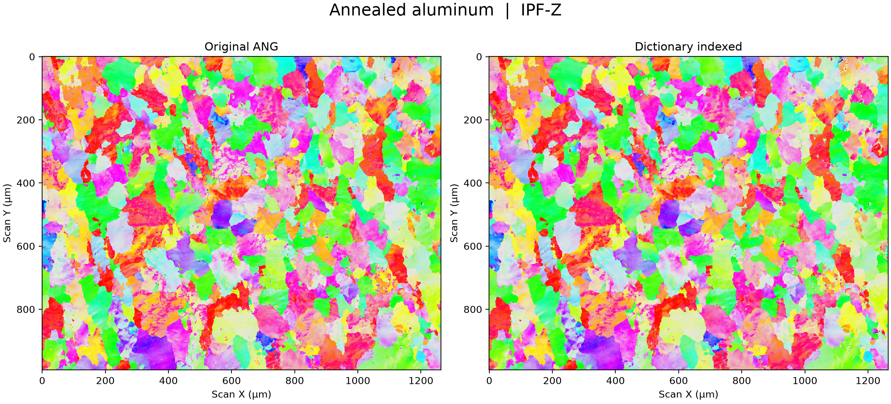

# Annealed aluminium — IPF-Z comparison

User-provided comparison of the original ANG map (left) and dictionary-indexed map (right). Scan coordinates are in micrometres.

This image is a visual example. Raw UP patterns, master patterns and indexed orientation data are not included in this folder.
